# System Design — `<nome-do-aplicativo>`

> **Template version:** 1.0 (2026-11-09) · **Mantido por:** `agent-architect` ·
> **Modelo:** [`docs/system-design/README.md`](https://github.com/b3ll3o/projeto-base/blob/main/docs/system-design/README.md)

<!--
Preencha em 7 blocos, na ordem. O leitor percorre de cima para baixo:
contexto → contêineres → módulos → dados → segurança → operação → ambientes.

Em cada bloco:
  1. o que é (2-4 linhas);
  2. o diagrama, na linguagem visual do projeto-base (a forma carrega o tipo);
  3. a tabela com o que o leitor precisa saber;
  4. o PONTEIRO para o ADR dono de cada decisão — o System Design aponta,
     não repete.

Regra da medição: todo número vem com o comando que o produz.
-->

## 1. Contexto e contêineres

<!--
QUEM usa o sistema, O QUE ele faz, onde está a fronteira de confiança — e
quais são os contêineres (o que sobe sempre, o que é opcional, e a rede que
separa).
-->

> **Medido em `<AAAA-MM-DD>`:** <o que foi conferido e contra o quê>

### 1.1 Atores

| Ator | O que quer | Como entra |
|---|---|---|
| `<ator>` | `<necessidade>` | `<HTTPS · sessão>` |

### 1.2 A fronteira de confiança

```mermaid
%%{init: {"theme":"base","themeVariables":{"fontFamily":"ui-sans-serif, system-ui, sans-serif","primaryColor":"#dbeafe","primaryTextColor":"#1e3a8a","primaryBorderColor":"#1d4ed8","lineColor":"#64748b","textColor":"#0f172a","mainBkg":"#f8fafc","background":"#ffffff","clusterBkg":"#f8fafc","clusterBorder":"#cbd5e1","edgeLabelBackground":"#ffffff","fontSize":"14px"},"flowchart":{"curve":"basis","nodeSpacing":45,"rankSpacing":55,"padding":12,"htmlLabels":true,"useMaxWidth":true}}}%%
flowchart TB
  ator(["<ator>"])
  sistema["<sistema>"]
  ator -->|"<protocolo>"| sistema
  classDef ator fill:#ede9fe,stroke:#6d28d9,color:#2e1065,stroke-width:1px
  classDef app fill:#dbeafe,stroke:#1d4ed8,color:#1e3a8a,stroke-width:1px
  class ator ator
  class sistema app
```

<!-- Desenhe a fronteira e diga, em UMA frase, o que a fecha. -->



| Fronteira | O que atravessa | Quem decide | Falha em profundidade |
|---|---|---|---|
| `<1>` | `<o que>` | `<quem>` | `<o que fecha>` |

**Decisões desta seção:** `<ADR-XXXX — o que ela decide>`.

### 1.3 Os contêineres

<!-- A topologia: o que sobe sempre, o que é opcional, e a rede que separa. -->

| Contêiner | O que é | Sempre ativo? | Rede |
|---|---|---|---|
| `<nome>` | `<uma frase>` | `<sim / profile X>` | `<rede>` |

<!--
Desenhe o diagrama com a regra: contêiner = retângulo azul, dado = cilindro
verde, observabilidade = hexágono âmbar, externo = paralelogramo cinza.
-->

**Decisões desta seção:** `<ADR-XXXX>`.

## 2. Módulos

<!-- Os bounded contexts e a regra de dependência. -->

| Módulo | `domain/` | `application/` | `infrastructure/` |
|---|---|---|---|
| `<bc>` | `<o que>` | `<o que>` | `<o que>` |

```text
domain         ─→ (nada além de TypeScript padrão)
  ↑
application    ─→ domain + as próprias ports
  ↑
infrastructure ─→ application + domain + libs externas
```

**Onde uma peça nova entra** (é o que o próximo time vai perguntar):

| Preciso de… | Entra em |
|---|---|
| `<peça>` | `<caminho>` |

**Decisões desta seção:** `<ADR-XXXX — a boundary>`.

## 3. Dados

<!-- Onde o dado mora, sob que escopo, e o que o sistema NÃO tem. -->

| Tabela | Escopo | Quem escreve | Quem lê |
|---|---|---|---|
| `<tabela>` | `<global / por empresa>` | `<port>` | `<port>` |

**Consistência:** `<forte local / eventual — e por quê>`

**Concorrência:** `<locking otimista com version · ETag / If-Match — ou o que for>`

**Lacunas declaradas** — o que **não** existe, escrito com precisão:

- `<ex.: não há Idempotency-Key; re-executar responde 409, e o retry não é seguro>`
- `<ex.: não há fila; nada notifica>`

**Decisões desta seção:** `<ADR-XXXX>`.

## 4. Segurança

<!-- As ameaças e o que fecha cada uma. Uma linha por ameaça. -->

| # | Superfície | O ataque | O que fecha | Onde |
|---|---|---|---|---|
| 1 | `<superfície>` | `<ataque>` | `<mecanismo>` | `<arquivo:linha>` |

**Credenciais:**

| Credencial | Papel | Alcança | Quando |
|---|---|---|---|
| `<URI>` | `<papel>` | `<o que>` | `<quando>` |

**Segredos:** `<onde vivem, e a regra que impede o valor de exemplo>`

**Decisões desta seção:** `<ADR-XXXX>`.

## 5. Operação

<!-- Telemetria, SLO, escala, degradação. -->

**Telemetria:** `<quem emite, quem coleta, quem guarda, o que decide o sampling>`

**Correlação:** `<o identificador que amarra log, trace e auditoria — e a ordem de precedência>`

**SLO** *(proposta — o repositório não define metas)*:

| SLI | Definição | Meta | Por que |
|---|---|---|---|
| `<SLI>` | `<medida>` | `<valor>` | `<razão>` |

**Escala:** `<o que escala horizontalmente, o que não, e o limite>`

**Degradação:** `<o que acontece quando cada peça cai>`

**Decisões desta seção:** `<ADR-XXXX>`.

### 5.1 Os ambientes

<!-- Os ambientes e o dono de cada um. -->

| # | Ambiente | Como se sobe | Dono |
|---|---|---|---|
| 1 | `<ambiente>` | `<comando>` | `<runbook>` |

**Contrato HTTP:** `<prefixo, versionamento, formato de erro, onde a spec vive>`

## 6. Extensão

<!--
O CONTRATO DE EXTENSÃO: a matriz de onde cada peça nova encaixa, e o
checklist de conformidade. É o bloco que faz o app derivado *estender* o
padrão em vez de só copiá-lo.
-->

| Peça nova | Onde encaixa | O que o derivado precisa |
|---|---|---|
| `<bounded context>` | `<caminho>` | `<o que falta>` |

**Checklist de conformidade:** `<os itens, um por linha, com o comando que confere cada um>`

---

## Ver Também

- `<o ADR-0010 do derivado, se houver>`
- `<o doc de API de cada BC>`
- `<os runbooks>`

---

**Mantido por:** `<equipe>`
**Versão do documento:** 1.0.0
