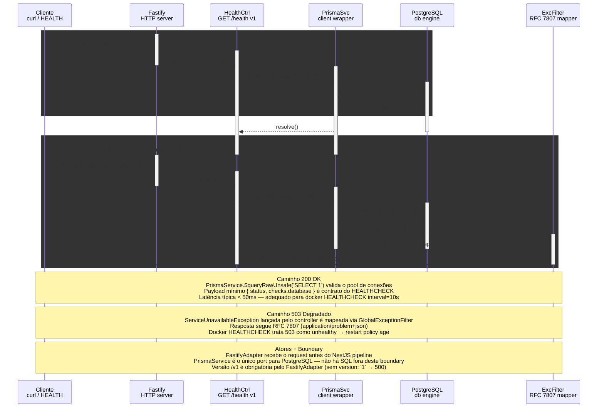

# Health Check — GET /api/v1/health

> Liveness/readiness do apps/api (NestJS + Fastify + PrismaService + PostgreSQL)

> Diagrama derivado da IR `docs/flows/http-api/http-api-health-check/http-api-health-check.sequence.json` pelo conversor
> `tooling/scripts/flow-ir-to-mermaid.ts` — regenerar com
> `pnpm tsx tooling/scripts/flow-ir-to-mermaid.ts --diagram=sequence --write`.
> O `.html` ao lado (~813 KB) foi produzido pelo `archify flow`, removido;
> segue versionado como histórico e não é regenerável.

## Views

> A IR declara N views; Mermaid não tem troca de view, então o diagrama
> acima é a união e o conteúdo específico de cada uma fica aqui.

| View | Rótulo | Foco | Nota |
|------|--------|------|------|
| `happy-path` | DB up → 200 | `client`, `fastify`, `controller`, `prisma`, `postgres` | SELECT 1 retorna → 200 com payload { ok, database, timestamp }. |
| `degraded-path` | DB down → 503 | `client`, `fastify`, `controller`, `prisma`, `postgres`, `filter` | PrismaService.$queryRawUnsafe rejeita → ServiceUnavailableException → GlobalExceptionFilter → RFC 7807. |
