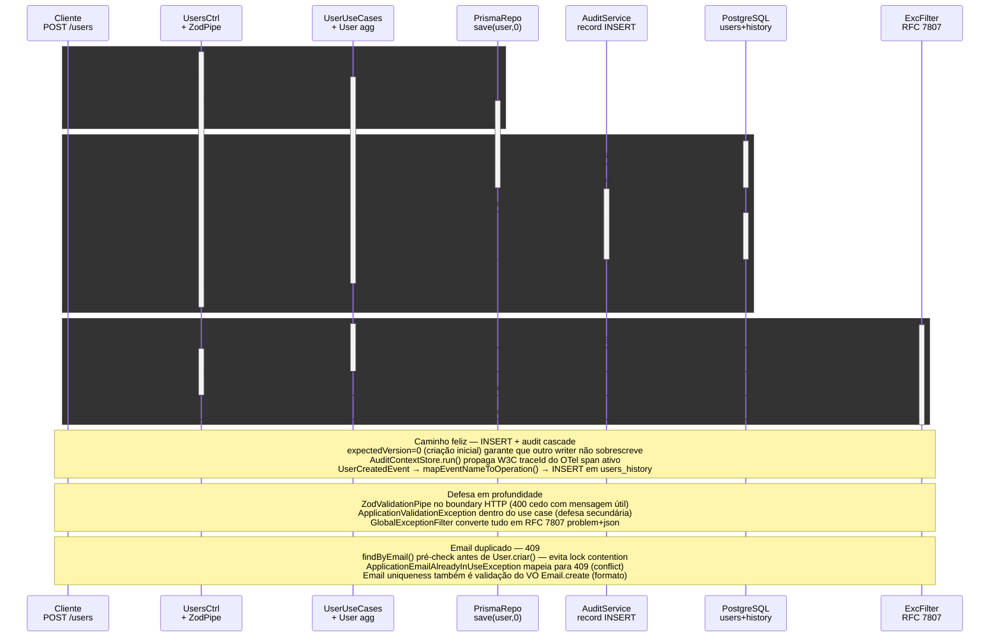

# POST /users — Criar Usuário (com cascade de auditoria)

> POST /users → UsersController (+ ZodValidationPipe) → UserUseCases → User aggregate → PrismaUserRepo → PostgreSQL + AuditServicePort → users_history

> Diagrama derivado da IR `docs/flows/http-api/http-api-users-create/http-api-users-create.sequence.json` pelo conversor
> `tooling/scripts/flow-ir-to-mermaid.ts` — regenerar com
> `pnpm tsx tooling/scripts/flow-ir-to-mermaid.ts --diagram=sequence --write`.
> O `.html` ao lado (~813 KB) foi produzido pelo `archify flow`, removido;
> segue versionado como histórico e não é regenerável.

## Views

> A IR declara N views; Mermaid não tem troca de view, então o diagrama
> acima é a união e o conteúdo específico de cada uma fica aqui.

| View | Rótulo | Foco | Nota |
|------|--------|------|------|
| `happy-path` | CREATE caminho feliz | `client`, `controller`, `usecases`, `repo`, `audit` | INSERT user + INSERT audit record (UserCreatedEvent). |
| `validation-409` | Email duplicado → 409 | `client`, `controller`, `usecases`, `repo`, `filter` | findByEmail pré-check lança ApplicationEmailAlreadyInUseException → 409. |
| `validation-400` | Payload inválido → 400 | `client`, `controller`, `filter` | ZodValidationPipe rejeita DTO antes do handler (defense-in-depth). |
