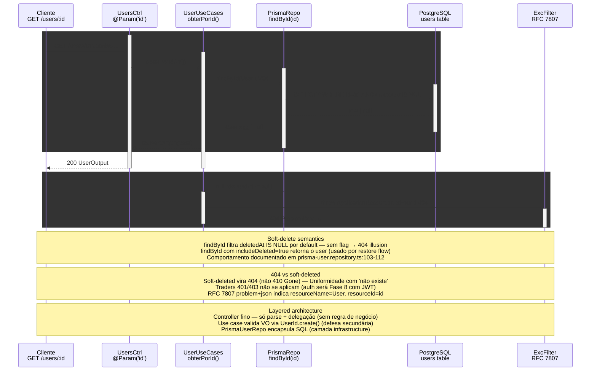

# GET /users/:id — Buscar por ID (soft-deleted omitido por default)

> GET /users/:id → UsersController → UserUseCases.obterPorId → UserRepository.findById (deletedAt=null filter) → Prisma → PostgreSQL

> Diagrama derivado da IR `docs/flows/http-api/http-api-users-get-by-id/http-api-users-get-by-id.sequence.json` pelo conversor
> `tooling/scripts/flow-ir-to-mermaid.ts` — regenerar com
> `pnpm tsx tooling/scripts/flow-ir-to-mermaid.ts --diagram=sequence --write`.
> O `.html` ao lado (~813 KB) foi produzido pelo `archify flow`, removido;
> segue versionado como histórico e não é regenerável.

## Views

> A IR declara N views; Mermaid não tem troca de view, então o diagrama
> acima é a união e o conteúdo específico de cada uma fica aqui.

| View | Rótulo | Foco | Nota |
|------|--------|------|------|
| `happy-path` | User ativo → 200 | `client`, `controller`, `usecases`, `repo`, `pg` | User existe, deletedAt=null → retorna UserOutput. |
| `soft-deleted-404` | Soft-deleted omitido → 404 | `client`, `controller`, `usecases`, `repo`, `pg`, `filter` | deletedAt IS NOT NULL → repo retorna null → ApplicationResourceNotFoundException → 404. |
