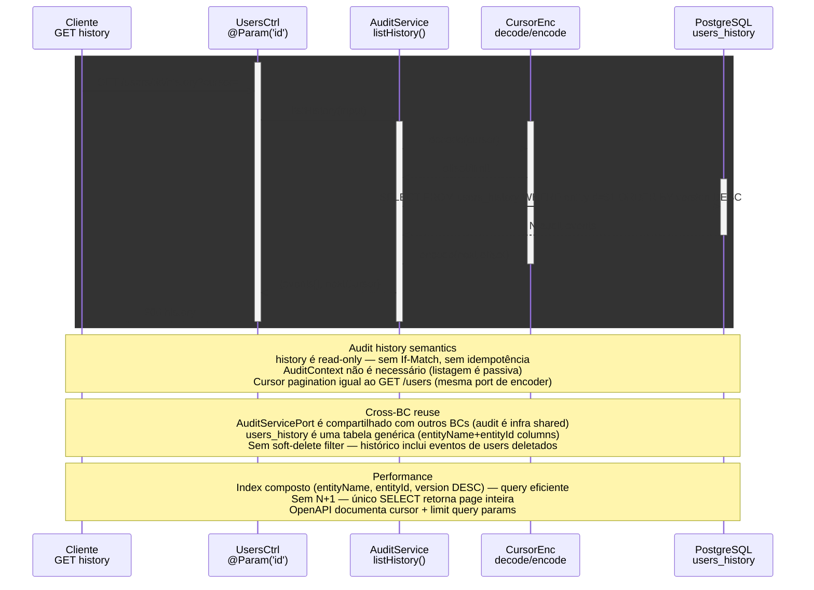

# GET /users/:id/history — Audit history paginado

> GET /users/:id/history?cursor=... → UsersController → AuditServicePort.listHistory → users_history table

> Diagrama derivado da IR `docs/flows/http-api/http-api-users-history/http-api-users-history.sequence.json` pelo conversor
> `tooling/scripts/flow-ir-to-mermaid.ts` — regenerar com
> `pnpm tsx tooling/scripts/flow-ir-to-mermaid.ts --diagram=sequence --write`.
> O `.html` ao lado (~813 KB) foi produzido pelo `archify flow`, removido;
> segue versionado como histórico e não é regenerável.

## Views

> A IR declara N views; Mermaid não tem troca de view, então o diagrama
> acima é a união e o conteúdo específico de cada uma fica aqui.

| View | Rótulo | Foco | Nota |
|------|--------|------|------|
| `happy-path` | History cursor pagination | `client`, `controller`, `audit`, `pg` | AuditServicePort.listHistory(entityName=User, entityId) → cursor-based page. |
