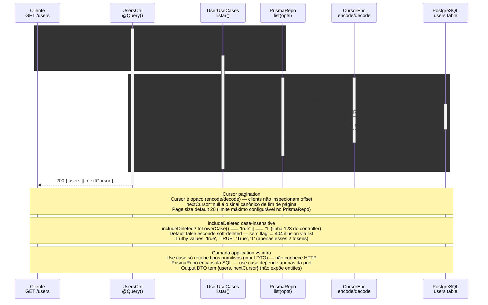

# GET /users — Listar (cursor paginado + includeDeleted)

> GET /users?cursor=...&includeDeleted=... → UsersController → UserUseCases.listar → UserRepositoryPort.list → Prisma + cursor encoder

> Diagrama derivado da IR `docs/flows/http-api/http-api-users-list/http-api-users-list.sequence.json` pelo conversor
> `tooling/scripts/flow-ir-to-mermaid.ts` — regenerar com
> `pnpm tsx tooling/scripts/flow-ir-to-mermaid.ts --diagram=sequence --write`.
> O `.html` ao lado (~813 KB) foi produzido pelo `archify flow`, removido;
> segue versionado como histórico e não é regenerável.

## Views

> A IR declara N views; Mermaid não tem troca de view, então o diagrama
> acima é a união e o conteúdo específico de cada uma fica aqui.

| View | Rótulo | Foco | Nota |
|------|--------|------|------|
| `happy-path` | Cursor paginated list | `client`, `controller`, `usecases`, `repo`, `cursor`, `pg` | Lista página de users; nextCursor opaco para próxima página. |
| `include-deleted` | includeDeleted parsing | `client`, `controller`, `usecases`, `repo` | includeDeleted=TrUe|TRUE|1 case-insensitive normalized to boolean true. |
