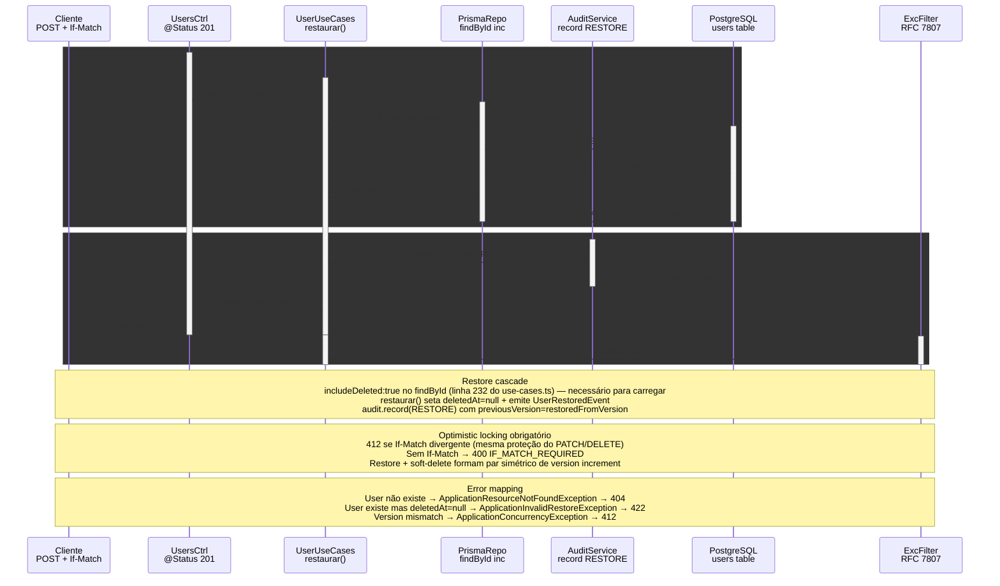

# POST /users/:id/restore — Restaurar soft-deleted

> POST /users/:id/restore (If-Match) → findById(includeDeleted) → restaurar() → UPDATE users + audit RESTORE

> Diagrama derivado da IR `docs/flows/http-api/http-api-users-restore/http-api-users-restore.sequence.json` pelo conversor
> `tooling/scripts/flow-ir-to-mermaid.ts` — regenerar com
> `pnpm tsx tooling/scripts/flow-ir-to-mermaid.ts --diagram=sequence --write`.
> O `.html` ao lado (~813 KB) foi produzido pelo `archify flow`, removido;
> segue versionado como histórico e não é regenerável.

## Views

> A IR declara N views; Mermaid não tem troca de view, então o diagrama
> acima é a união e o conteúdo específico de cada uma fica aqui.

| View | Rótulo | Foco | Nota |
|------|--------|------|------|
| `happy-path` | Restore → 201 | `client`, `controller`, `usecases`, `repo`, `audit`, `pg` | User soft-deletado restaurado, deletedAt=NULL, ETag atualizado. |
| `errors` | 404/412/422 | `client`, `controller`, `usecases`, `filter` | User não existe → 404; versão mismatch → 412; já ativo → 422. |
