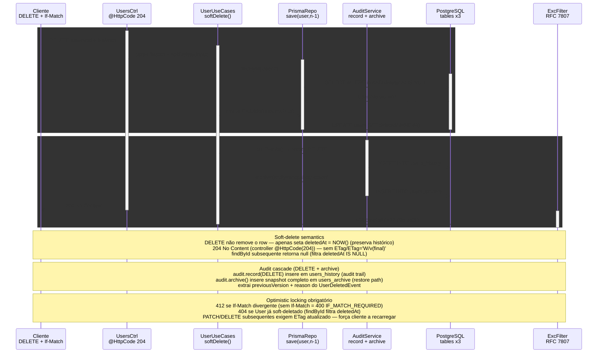

# DELETE /users/:id — Soft-delete com audit + archive

> DELETE /users/:id (If-Match) → marcarExcluido + audit.record(DELETE) + audit.archive → users_archive

> Diagrama derivado da IR `docs/flows/http-api/http-api-users-soft-delete/http-api-users-soft-delete.sequence.json` pelo conversor
> `tooling/scripts/flow-ir-to-mermaid.ts` — regenerar com
> `pnpm tsx tooling/scripts/flow-ir-to-mermaid.ts --diagram=sequence --write`.
> O `.html` ao lado (~813 KB) foi produzido pelo `archify flow`, removido;
> segue versionado como histórico e não é regenerável.

## Views

> A IR declara N views; Mermaid não tem troca de view, então o diagrama
> acima é a união e o conteúdo específico de cada uma fica aqui.

| View | Rótulo | Foco | Nota |
|------|--------|------|------|
| `happy-path` | Soft-delete cascade → 204 | `client`, `controller`, `usecases`, `repo`, `audit`, `pg` | marcarExcluido + UPDATE users + INSERT history + INSERT archive. |
| `errors` | 404/412 error paths | `client`, `controller`, `usecases`, `filter` | User não existe ou já deletado → 404; versão mismatch → 412. |
