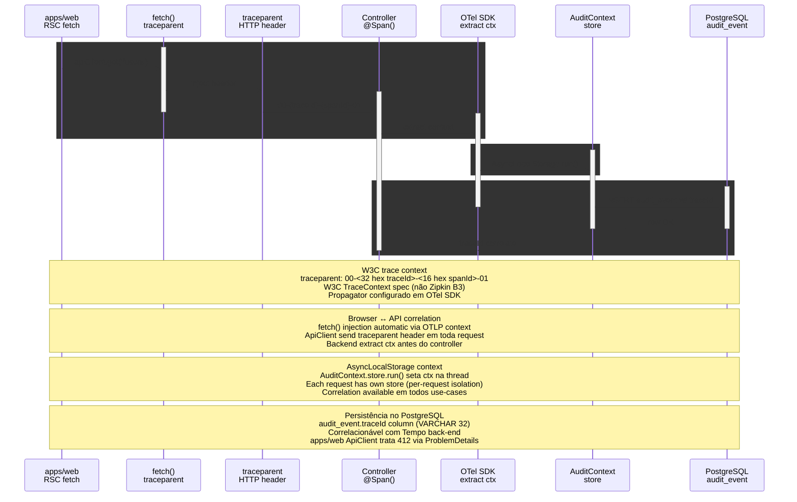

# Telemetry W3C traceId Propagation

> Browser RSC → traceparent header → NestJS Controller span → AuditContext store → PostgreSQL

> Diagrama derivado da IR `docs/flows/telemetry-observability/telemetry.http.w3c.traceid.propagation.sequence/telemetry.http.w3c.traceid.propagation.sequence.sequence.json` pelo conversor
> `tooling/scripts/flow-ir-to-mermaid.ts` — regenerar com
> `pnpm tsx tooling/scripts/flow-ir-to-mermaid.ts --diagram=sequence --write`.
> O `.html` ao lado (~813 KB) foi produzido pelo `archify flow`, removido;
> segue versionado como histórico e não é regenerável.

## Views

> A IR declara N views; Mermaid não tem troca de view, então o diagrama
> acima é a união e o conteúdo específico de cada uma fica aqui.

| View | Rótulo | Foco | Nota |
|------|--------|------|------|
| `propagation` | traceId propagation | `rsc`, `fetch`, `traceparent`, `controller`, `otel`, `audit`, `pg` | W3C trace context flui browser→API→DB com correlação. |
