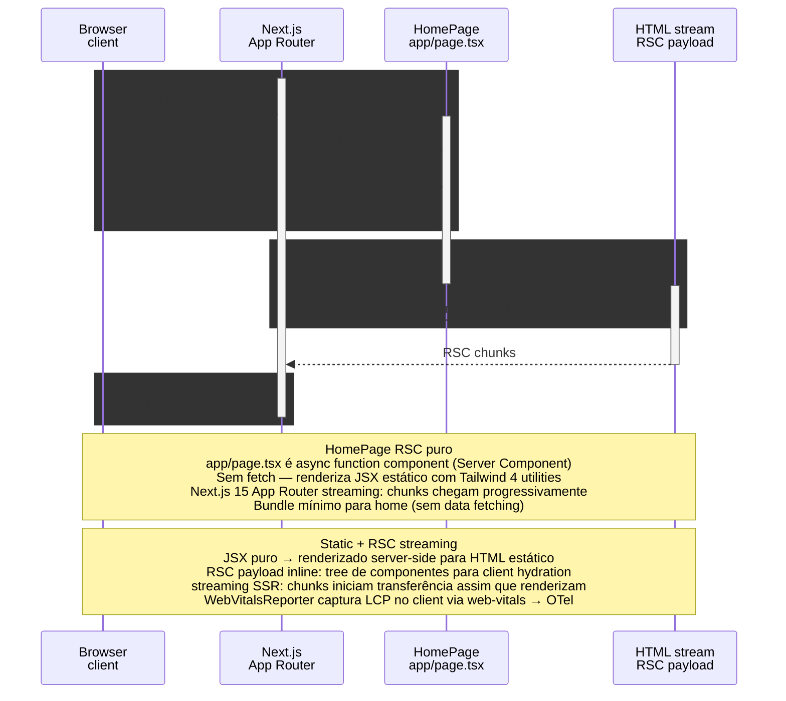

# apps/web — Home Page SSR Render

> Browser → Next.js (RSC) → HomePage component → HTML stream

> Diagrama derivado da IR `docs/flows/web-app/web-app-flow-01/web-app-flow-01.sequence.json` pelo conversor
> `tooling/scripts/flow-ir-to-mermaid.ts` — regenerar com
> `pnpm tsx tooling/scripts/flow-ir-to-mermaid.ts --diagram=sequence --write`.
> O `.html` ao lado (~813 KB) foi produzido pelo `archify flow`, removido;
> segue versionado como histórico e não é regenerável.

## Views

> A IR declara N views; Mermaid não tem troca de view, então o diagrama
> acima é a união e o conteúdo específico de cada uma fica aqui.

| View | Rótulo | Foco | Nota |
|------|--------|------|------|
| `ssr-home` | Home SSR | `browser`, `next`, `rsc_home`, `html_stream` | HomePage é RSC puro (sem data fetch) — Server Component renderiza JSX para HTML stream. |
