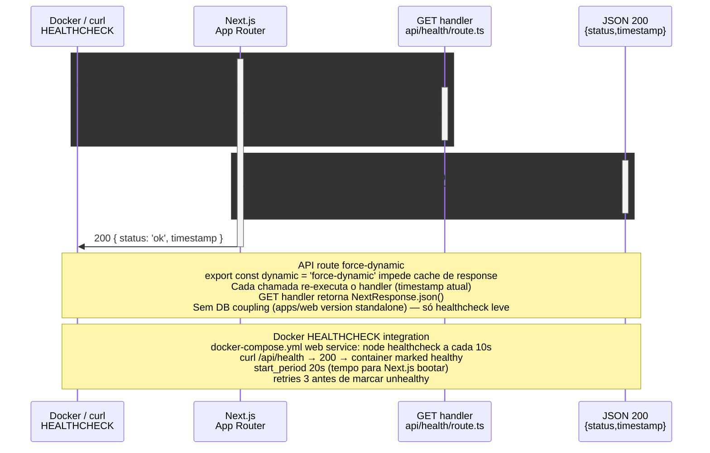

# apps/web — Health Check API Route

> Browser/Docker → Next.js API route /api/health → JSON response

> Diagrama derivado da IR `docs/flows/web-app/web-app-flow-03/web-app-flow-03.sequence.json` pelo conversor
> `tooling/scripts/flow-ir-to-mermaid.ts` — regenerar com
> `pnpm tsx tooling/scripts/flow-ir-to-mermaid.ts --diagram=sequence --write`.
> O `.html` ao lado (~813 KB) foi produzido pelo `archify flow`, removido;
> segue versionado como histórico e não é regenerável.

## Views

> A IR declara N views; Mermaid não tem troca de view, então o diagrama
> acima é a união e o conteúdo específico de cada uma fica aqui.

| View | Rótulo | Foco | Nota |
|------|--------|------|------|
| `health-route` | Health endpoint | `client`, `next`, `api_route`, `json_response` | API route estática (force-dynamic), usada por Docker healthcheck do container web. |
