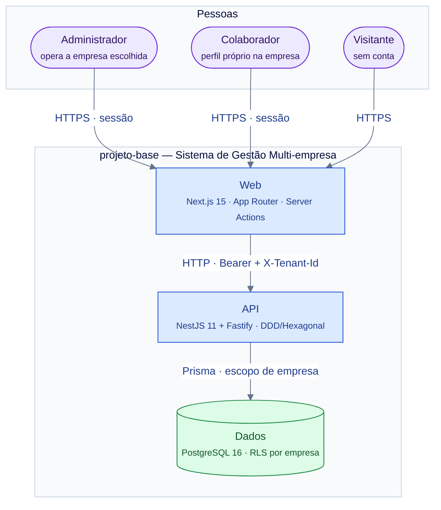
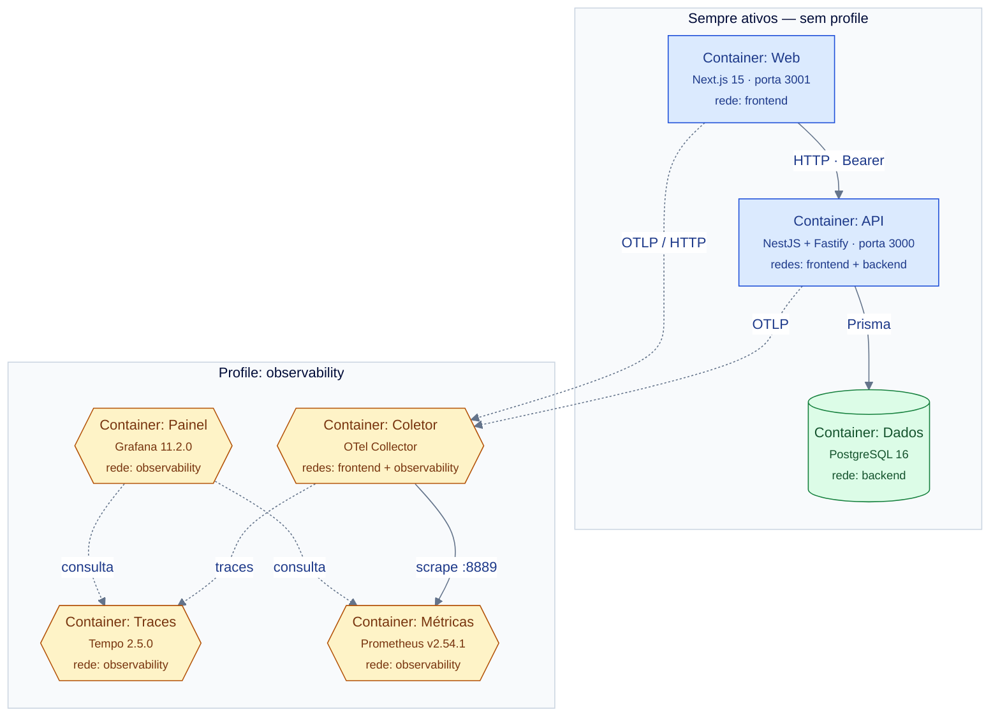
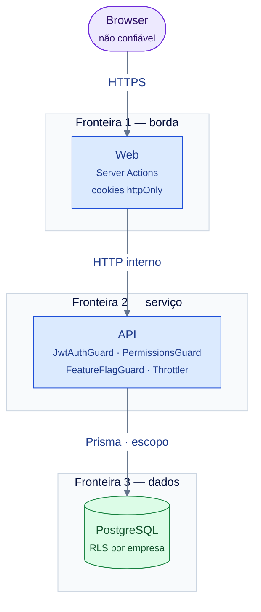

# System Design — Contexto e Contêineres

> **Nível C4:** L1 (contexto do sistema) + L2 (contêineres).
> **Medido em 2026-11-09:** a topologia abaixo confere com `docker-compose.yml`
> (`docker compose --profile observability config --services` → **7**
> serviços: 3 sem profile, 4 no profile `observability`) e com
> `apps/api/src/main.ts`.
> **Dono do desenho:** este documento. **Dono das decisões:** cada ADR
> citado. **Dono do fluxo detalhado:** `docs/flows/`.

---

## §1. C4 — Nível 1: o contexto

O sistema é um **sistema de gestão multi-empresa**: uma conta global, N
empresas, e um perfil **dentro** de cada empresa. O ator principal não é o
usuário final — é o **administrador da empresa**, que opera no tenant que
escolheu.

**O que o diagrama afirma, e onde cada afirmação mora:**

| Afirmação | Dono |
|---|---|
| O browser **nunca** fala com a API — todo tráfego passa por Server Action | `apps/web/lib/sessao.ts:9-14` |
| A API exige `Authorization: Bearer` e, opcionalmente, `X-Tenant-Id` | [ADR-0004](../adr/0004-tenancy-multi-empresa.md) |
| O banco isola por empresa **na camada de banco**, não só na aplicação | [ADR-0004](../adr/0004-tenancy-multi-empresa.md) |

---

## §2. C4 — Nível 2: os contêineres

Sete serviços no Compose — mas **três sobem sempre** e **quatro só com o
profile `observability`**. A rede **é** parte do desenho: três redes, e a
regra de isolamento entre elas.

### §2.1 A regra de isolamento entre redes

| Rede | Quem entra | Regra |
|---|---|---|
| `frontend` | `web`, `api`, `otel-collector` | a camada que **serve página** e a que **fala HTTP** |
| `backend` | `postgres`, `api` | a camada de **dados** — o web não alcança o banco |
| `observability` | `otel-collector`, `tempo`, `prometheus`, `grafana` | a stack que **mostra** o que a aplicação fez **não precisa alcançar o `postgres`**, nem é alcançável a partir do `web` |

> A justificativa da terceira rede está no próprio Compose
> (`docker-compose.yml:510-518`): a observabilidade é separada **de
> propósito**, para o painel não virar uma porta de entrada para o banco.

### §2.2 O que cada contêiner é, em uma frase

| Contêiner | Imagem | O que é | Dono do detalhe |
|---|---|---|---|
| **Web** | build de `apps/web/Dockerfile` | Servidor Next.js que serve a UI e executa as Server Actions | [`docs/web/rotas.md`](../web/rotas.md) |
| **API** | build de `apps/api/Dockerfile` | API HTTP NestJS sobre Fastify, com os 6 bounded contexts | [`docs/api/`](../api/) |
| **Dados** | `postgres:16-alpine` (por digest) | Banco único; fonte de registro do sistema | [`docs/system-design/dados.md`](./dados.md) |
| **Coletor** | `otel/opentelemetry-collector-contrib:0.103.0` | Recebe OTLP, aplica sampling, exporta | [`docs/runbooks/observabilidade.md`](../runbooks/observabilidade.md) |
| **Traces** | `grafana/tempo:2.5.0` | Guarda os traces | idem |
| **Métricas** | `prom/prometheus:v2.54.1` | Scrape as métricas do coletor | idem |
| **Painel** | `grafana/grafana:11.2.0` | Tela | idem |

### §2.3 O que este desenho **não** tem

- ❌ **Fila / mensageria.** Nenhum broker: nenhum serviço de fila existe
  (`grep -l 'bullmq\|redis\|kafka' apps/*/package.json` → nada).
- ❌ **Cache distribuído.** Nenhum Redis: o único cache é **in-process**, de
  5 s, e ele é do **perfil**, não do dado (ver
  [`seguranca.md`](./seguranca.md) §Autorização).
- ❌ **Service mesh / API gateway.** A borda é o próprio web.
- ❌ **CDN / edge no caminho da aplicação.** A Cloudflare aparece num
  **runbook de verificação da conta** (TLS, HSTS, MFA, DNSSEC) — ele entrega
  o contrato de conferência, para uma pessoa, no dashboard
  ([`docs/runbooks/cloudflare-edge.md`](../runbooks/cloudflare-edge.md)); não
  é um componente do caminho da requisição.

---

## §3. A fronteira de confiança

Três fronteiras, e cada uma tem **um** mecanismo de defesa — não três.

| Fronteira | O que atravessa | Quem decide | Falha em profundidade |
|---|---|---|---|
| **1 — borda** | HTTPS do browser | Next.js: cookie `httpOnly`, CSP, `X-Tenant-Id` **não** httpOnly (é escolha de UI, não credencial) | helmet + CORS whitelist na API (`main.ts:48-91`) |
| **2 — serviço** | HTTP interno + `Authorization: Bearer` | `JwtAuthGuard` + `PermissionsGuard` + `FeatureFlagGuard` | validação Zod no boundary **e** VO no domínio |
| **3 — dados** | Prisma, com escopo | **o banco**, pela policy | RLS: o app erra e ainda assim lê zero linhas |

> **A fronteira 3 é a única que sobrevive ao bug.** As duas primeiras
> dependem do código estar certo; a terceira depende do **banco** recusar.
> Por isso ela é a que o [ADR-0004](../adr/0004-tenancy-multi-empresa.md)
> trata em detalhe.

---

## §4. Trade-offs: o que foi decidido, e o que se pagou

Cada linha é uma decisão **já registrada** — o motivo completo está no ADR
citado. Aqui está o resumo e **o preço**.

| Decisão | Alternativa rejeitada | O que se paga |
|---|---|---|
| **Schema único + `tenant_id` + RLS** | schema-per-tenant, db-per-tenant | o isolamento não é por schema: `users` e `users_history` **não** têm `tenant_id` e são isolados por `usuario_no_escopo()`, que faz `EXISTS` sobre `tenant_memberships` — a policy mais cara do banco |
| **Bucket de sistema por credencial** | bucket concedido por GUC (`app.tenant_id = '*'`) | são **duas** URIs e **dois** papéis; `SYSTEM_DATABASE_URL` é obrigatória fora de `development` |
| **Contexto de empresa no header**, não no token | claim `tenant_id` no JWT | trocar de empresa **não** emite token novo — e o token continua sendo de identidade |
| **Refresh token revogável** (tabela `refresh_tokens`) | JWT stateless sem registro | a tabela é `REVOKE` de `app_runtime`: login/refresh/logout falam com ela pela **credencial de sistema** |
| **`FORCE ROW LEVEL SECURITY` não usado** | forçar RLS até o dono | migrations e seed continuam podendo escrever em tudo — quem audita isolamento tem de perguntar **quem conecta** |
| **Perfil por membership** (`tenant_memberships.profile_id`) | coluna `tenant_id` na conta | uma conta pode estar em N empresas, e o perfil **por empresa** só é representável com a tabela de vínculo |
| **JWT stateless** no access token | sessão no servidor | revogar o access token **não** é operação; o que é revogável é o refresh |
| **Sem cache distribuído** | Redis | leitura de perfil vai ao banco a cada request (há um cache in-process de 5 s — ver §7) |

---

## §5. O contrato HTTP: a **política**, não a lista

> A lista de endpoints **não** é deste documento. Ela é de
> [`docs/api/<bc>.md`](../api/) (o contrato legível) e do
> `apps/api/openapi.json` versionado (o contrato gerado). Aqui só mora a
> **política**.

| Regra | Valor | Onde |
|---|---|---|
| Prefixo | `/api/v1` — o prefixo é **global**, definido uma vez | `apps/api/src/main.ts:41` |
| Versionamento | breaking change abre `/api/v2`; o `v1` não se reescreve | política do time |
| Verificação de drift | o `openapi.json` versionado é comparado com o gerado no preflight | gate `check-openapi-contract` |
| Formato de erro | **shape** RFC 7807 (Problem Details) servido como `application/json` — o repo **não** emite `application/problem+json` | `shared/infrastructure/http/global-exception.filter.ts:74` |
| Documentação viva | o Swagger só existe em `development` — **salvo** `SWAGGER_ENABLED=true`, que tem precedência nos dois sentidos | `shared/infrastructure/http/swagger-habilitado.ts` |

**Rotação de rota por perfil (frontend)**: o catálogo é
[`docs/web/rotas.md`](../web/rotas.md).

---

## §6. Onde o caminho detalhado mora

Este documento desenha a **topologia**. O caminho de um request, passo a
passo, tem dono próprio — e não é este:

| Caminho | Dono |
|---|---|
| `POST /users` completo (validação → aggregate → auditoria → 409) | [`docs/flows/http-api/http-api-users-create/flow.md`](../flows/http-api/http-api-users-create/flow.md) |
| Composição dos módulos NestJS | [`docs/flows/http-api/http-api-nestjs-module-composition/` — a IR](../flows/http-api/http-api-nestjs-module-composition/http-api-nestjs-module-composition.architecture.json) |
| Topologia do Compose em dev | [`docs/flows/ci-cd-and-defenses/docker-compose-local-stack/` — a IR](../flows/ci-cd-and-defenses/docker-compose-local-stack/docker-compose-local-stack.architecture.json) |
| Pipeline de telemetria | [`docs/flows/telemetry-observability/telemetry.collector.otlp.pipeline.dataflow/` — a IR](../flows/telemetry-observability/telemetry.collector.otlp.pipeline.dataflow/telemetry.collector.otlp.pipeline.dataflow.dataflow.json) |
| Health check | [`docs/flows/http-api/http-api-health-check/flow.md`](../flows/http-api/http-api-health-check/flow.md) |

> **Por que o corte por profile e as redes não estão nos `flow.md`:** os
> fluxos descrevem **sequência**, e o corte por profile é **condição de
> implantação**. É o que este §2 acrescenta.

---

## Ver Também

- [`./modulo.md`](./modulo.md) — o nível 3: como um bounded context é
  construído.
- [`./dados.md`](./dados.md) — onde o dado mora.
- [`./seguranca.md`](./seguranca.md) — as ameaças e as defesas.
- [`./operacao.md`](./operacao.md) — telemetria, SLO, escala, ambientes.
- [`../STACK.md`](../STACK.md) — o dono das versões.

---

**Mantido por:** projeto-base contributors
**Versão do documento:** 1.0.0
