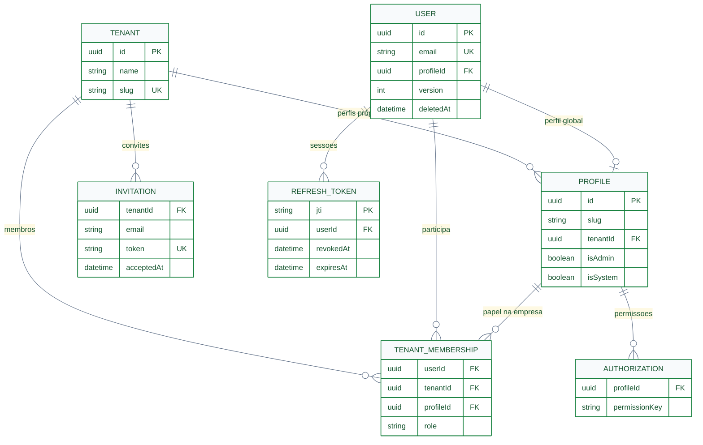
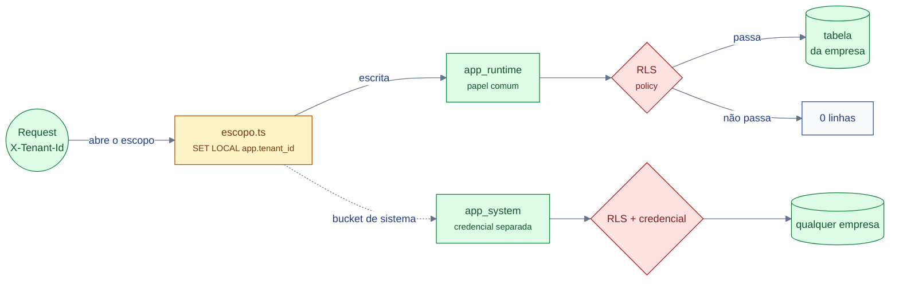

# System Design — Dados

> **Nível C4:** L4 (dados) — quem guarda o quê, e sob qual escopo.
> **Medido em 2026-11-10:** `apps/api/prisma/schema.prisma` (12 models) e as
> migrations de RLS.
> **Dono do modelo:** `apps/api/prisma/schema.prisma`. **Dono da política de
> escopo:** [ADR-0004](../adr/0004-tenancy-multi-empresa.md). Este documento
> **desenha** o que os dois dizem.

---

## §1. O modelo

12 models. O desenho abaixo é o **relacionamento real** — e ele tem uma
particularidade que o diagrama mostra: `users_history` e `users_archive`
**não têm chave estrangeira** para `users`.



### §1.1 Os seis models que **não** têm relação com FK

| Model | Por quê | Consequência |
|---|---|---|
| `users_history` | trilha de auditoria — guarda `entity_id` + `version` + snapshot JSONB | **não** é apagada em cascata; a integridade é lógica |
| `users_archive` | o "soft delete" materializado — `entity_id` `@unique` | o mesmo |
| `feature_flags` | o estado **global** das funcionalidades | **sem `tenant_id`, sem RLS** — por decisão: a flag responde "isto existe no sistema?", e a resposta é a mesma para todo ator |
| `chaves_de_assinatura` | o segredo que assina `criar_membership` | **o `REVOKE ALL` de `app_runtime` é o que exclui**; a RLS ligada **sem policy** é a segunda barreira |
| `refresh_tokens` | o registro do `jti` do refresh | **sem RLS**, e `REVOKE ALL` de `app_runtime`: só `app_system` lê |
| `idempotency_keys` | o registro da chave de idempotência de escrita | o mesmo: **sem RLS**, e `REVOKE ALL` de `app_runtime` — a resposta guardada é PII de outra empresa |

> `grep -rh "ALTER TABLE .* ENABLE ROW LEVEL SECURITY" apps/api/prisma/migrations/*/migration.sql | awk '{print $3}' | sort -u | wc -l` → **9**:
> `authorizations`, `chaves_de_assinatura`, `invitations`, `profiles`,
> `tenant_memberships`, `tenants`, `users`, `users_archive`, `users_history`.

---

## §2. O escopo de empresa

O dado **não** é marcado por empresa em toda parte: a pergunta "esta linha
pertence a qual empresa?" tem **duas** respostas no schema.

| Tabela | Como o escopo é determinado |
|---|---|
| `profiles`, `tenants`, `tenant_memberships`, `invitations`, `authorizations` | coluna `tenant_id` |
| `users` | **não tem `tenant_id`** — é global (1 conta, N empresas); o isolamento é o `EXISTS` sobre `tenant_memberships` |
| `users_history`, `users_archive` | idem — a policy usa `usuario_no_escopo(entity_id)`, que varre `tenant_memberships` |



**Três regras, e elas são o coração do isolamento:**

1. **O escopo é escrito em um lugar só** — `escopo.ts`. Nenhum outro arquivo
   escreve `app.tenant_id`.
2. **O escopo é escrito dentro da transação** (`set_config(..., true)`), ou
   ele vaza no pool e a requisição seguinte herda o escopo da anterior.
3. **O bucket de sistema é uma credencial**, não um valor: `app_runtime` com
   `'*'` lê **zero linhas**. Quem concede é `current_user = 'app_system'`.

> `FORCE ROW LEVEL SECURITY` **não** é usado — de propósito: migrations e seed
> precisam escrever em tudo. Quem audita isolamento pergunta **quem conecta**.

---

## §3. Fonte única do dado

**O PostgreSQL é o único sistema de registro.** Não há fila, não há cache
distribuído, não há busca externa, não há event store.

| Se o app precisa… | Vai para | Por quê |
|---|---|---|
| mostrar | o Postgres | é a fonte |
| notificar | **nada** — não há barramento | quem precisa saber descobre por leitura |
| recalcular | o Postgres, na própria requisição | não há worker, nem scheduler (`@nestjs/schedule` não está instalado) |
| auditar | `users_history` / `users_archive`, via `AuditServicePort` | a trilha é do banco, não de um log |

**O cache que existe** é **in-process** e de **5 s**
(`shared/infrastructure/security/user-profile-cache.service.ts`): carrega
`isAdmin` e o **array de permissões** — ou seja, a autorização **é** cacheada
junto. O que o TTL **não** cobre é o **veredito da membership**.

---

## §4. Consistência e concorrência

### §4.1 Consistência

| Operação | Consistência | Mecanismo |
|---|---|---|
| Qualquer escrita | **forte**, local | transação ACID do Postgres |
| Leitura multi-empresa | forte **dentro do escopo** | `SET LOCAL` na mesma transação |
| Escopo de sistema (bucket `*`) | forte | credencial `app_system` |
| Auditoria | forte | a gravação e o registro de auditoria são a mesma operação (cascade no use case) |

**Não há consistência eventual** em lugar nenhum — e não há replicação. Um
derivado que precise dela terá de introduzir a replicação **e** escolher a
consistência por leitura.

### §4.2 Concorrência — locking otimista

O dado mutável tem **`version`**, e a mutação passa por `If-Match`:

```text
cliente ──► PATCH /users/:id
            If-Match: W/"v3"          ← ETag devolvido na última resposta

a API compara expectedVersion com a linha:
  igual     → UPDATE … WHERE version = 3   → 1 linha   → 200 + ETag novo
  diferente → 0 linhas                    → 412 Precondition Failed
```

- A resposta mutante devolve `ETag: W/"v<n>"` (`users.controller.ts:203`).
- `If-Match` ausente ou malformado → **400**; divergência de versão → **412**.
- O `version` **só** sobe por um mutator do aggregate (`user.aggregate.ts:58`).

> **Por que optimistic e não pessimista:** o usuário é humano e a janela de
> edição é curta; um lock seguraria a transação à espera de um humano.

### §4.3 A trava da membership

`tenant_memberships` é a **credencial** que a RLS de `users` mede — quem pode
escrever nela fabrica autorização. A trava é uma função assinada ([`./seguranca.md`](./seguranca.md) §1).

---

## §5. Eventos de domínio → auditoria

O `users` emite **4 eventos** (`user-created`, `user-updated`,
`user-deleted`, `user-restored`). Eles **não** são publicados para fora: são
**drenados** pelo use case e viram **registro de auditoria**.

`aggregate → evento → user.pullEvents() → use case → auditService.record()`
vira `INSERT em users_history`; no soft-delete, `archive()` vira `INSERT em
users_archive`.

- O `AuditContext` (ator, `correlationId`, origem, timestamp) viaja num
  `AsyncLocalStorage` (`AuditContextStore`) — o use case não carrega o request.
- O `correlationId` vem da **mesma derivação do `traceId` da resposta**
  (`traceIdDe()`): span W3C ativo → `request.id` do Fastify → UUID fixado.
- O caminho completo está em [`docs/flows/http-api/http-api-domain-events-to-audit/` — a IR](../flows/http-api/http-api-domain-events-to-audit/http-api-domain-events-to-audit.workflow.json).

> ✅ **A divergência foi fechada (2026-11-10):** as duas derivações são a
> mesma função (`traceIdDe()`) — a resposta, o log e a exceção de
> persistência carregam **um** id. O `correlationId` **não é persistido**
> (`users_history` não tem coluna de trace): a correlação vale em tempo de
> request. Ver [`operacao.md`](./operacao.md) §Correlação.

---

## §6. Idempotência de escrita

**Existe desde 2026-11-10** — a decisão está no
[ADR-0011](../adr/0011-idempotencia-de-escrita.md). A chave é do cliente, no
header `Idempotency-Key`; sem o header, o pedido é o que era.

| Situação (POST, fora de `/auth`) | Resposta |
|---|---|
| Primeira vez | a operação roda (201) e a resposta é **guardada** |
| Repetida, **mesmo** pedido | **replay**: a mesma resposta (status, corpo e o `ETag`) e o header `Idempotency-Replayed: true` |
| Repetida, **outro** pedido | **409** `IDEMPOTENCY_KEY_REUSED` |
| Repetida, operação **em andamento** | **409** `IDEMPOTENCY_KEY_IN_FLIGHT` |
| Operação **não deu 2xx** | a chave é **liberada** — o retry executa de verdade |

O que é o **mesmo pedido**: o método, a rota **concreta** (com o path param
resolvido), o **escopo** (a empresa) e o **corpo**. A impressão é um **HMAC**
com o `JWT_SECRET` como pepper — não um SHA-256 do corpo, que seria um oráculo
de senha barato para quem lê a tabela.

O registro é a tabela `idempotency_keys`, do caminho de **SISTEMA** (sem
RLS, `REVOKE` do `app_runtime`) — como o `refresh_tokens`: a resposta guardada
é PII de outra empresa, e a RLS é o que impede o papel de runtime de ler a
base alheia. A chave vale **24 h** (poda no boot e a cada
100 reservas) e é escopada pelo **ator**: a chave de uma conta não vale para
outra. O bloco `/auth` fica de fora — a sessão tem semântica
própria (o refresh token é de uso único).

---

## §7. Migração de dados

A regra dos 3 passos é da convenção
[`migracao-de-dados.md`](../../.agents/specs/conventions/migracao-de-dados.md)
e ela é o que separa uma mudança de schema de uma mudança de dado:

1. **add nullable** — a coluna nova entra sem `NOT NULL`;
2. **backfill** — o dado é escrito;
3. **drop** — só quando nada mais precisa da coluna antiga.

**Exceção declarada, medida:** quando o backfill não tem o quê escrever
(o dado é novo, ou é um valor que o código calcula), o passo 2 vira um
`DEFAULT` no schema e a migração é uma só.

> **`FORCE ROW LEVEL SECURITY` não entra na migração** — e é por isso que
> migrations e seed podem escrever em tudo: quem migra usa a **credencial do
> dono**, não a de runtime.

---

## §8. O custo por empresa

O que cresce com o número de empresas:

| Recurso | Cresce com | Por quê |
|---|---|---|
| Linhas em `tenant_memberships` | **empresas × contas** | é a tabela que liga os dois |
| Custo do `EXISTS` da policy de `users` | **empresas** | o `EXISTS` varre `tenant_memberships` por linha avaliada — **é a policy mais cara do banco** |
| Índice parcial de `profiles.slug` | empresas | dois índices: um global (`tenant_id IS NULL`), um por empresa |
| I/O do banco | **empresas** | o Postgres é **um** banco, **uma** migration, **uma** operação |
| Custo de memória da aplicação | **não** | api e web são stateless |

**O que NÃO cresce:** número de migrations, de serviços, de instâncias. É o
preço da decisão "schema único + `tenant_id`" — e o
[ADR-0004](../adr/0004-tenancy-multi-empresa.md) registra a alternativa
rejeitada (schema-per-tenant / db-per-tenant) e o que ela custaria.

---

## Ver Também

- [`./seguranca.md`](./seguranca.md) — as credenciais e as ameaças.
- [`./operacao.md`](./operacao.md) — escala e o que acontece sob carga.
- [`../api/tenancy.md`](../api/tenancy.md) — o contrato HTTP do BC `tenancy`.
- [`../adr/0004-tenancy-multi-empresa.md`](../adr/0004-tenancy-multi-empresa.md)
  — a decisão do tenancy.

---

**Mantido por:** projeto-base contributors
**Versão do documento:** 1.0.0
