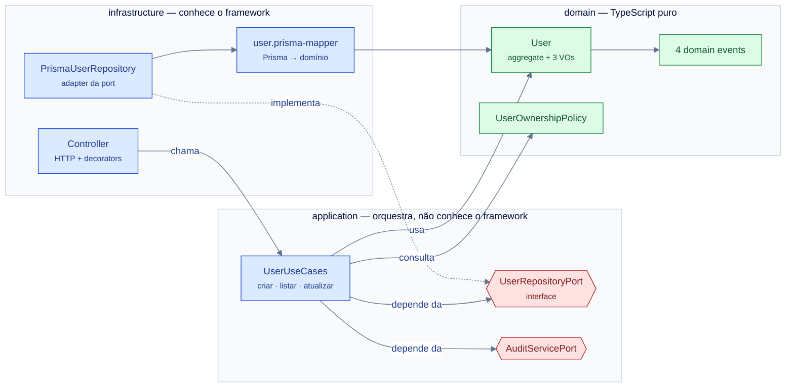
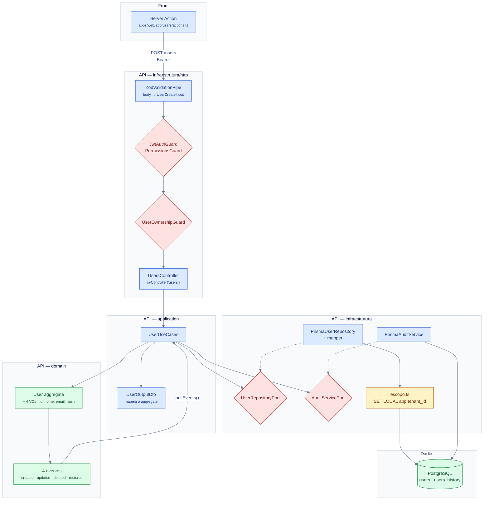
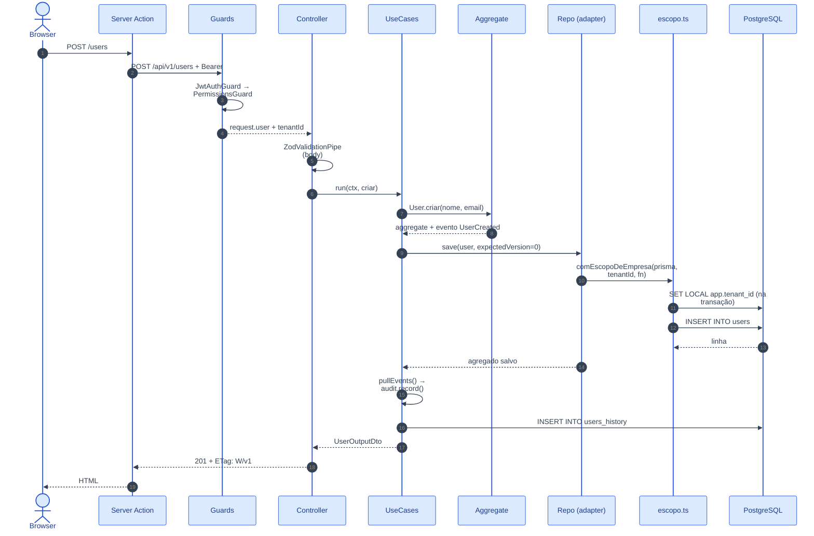

# System Design — Módulos e a cadeia de um request

> **Nível C4:** L3 (componentes de um bounded context).
> **Medido em 2026-11-09:** a árvore de `apps/api/src/modules/` e as regras de
> dependência confere com o código.
> **Dono do desenho:** este documento. **Dono da regra:** a convenção
> [`estrutura-e-versionamento.md`](../../.agents/specs/conventions/estrutura-e-versionamento.md)
> e o [ADR-0001](../adr/0001-arquitetura-ddd-hexagonal-auditoria.md).

---

## §1. Os 6 bounded contexts

`ls -d apps/api/src/modules/*/` → **6**. Cada um é um `domain` +
`application` + `infrastructure` — com uma exceção declarada.

| BC | `domain/` | `application/` | `infrastructure/` |
|---|---|---|---|
| **auth** | ports (`token-issuer`, `refresh-token-repository`), exceptions | `auth-use-cases.ts` + 3 DTOs | controller, `JwtAuthGuard`, `@Public()`, `Argon2PasswordHasher`, repositório de refresh |
| **users** | aggregate `User`, **4 VOs**, policy de posse, **4 eventos**, **2 ports** | `user-use-cases.ts` + **9 DTOs** | controller, schemas Zod, `UserOwnershipGuard`, repositório Prisma + mapper + repositório in-memory |
| **tenancy** | `perfis-da-empresa`, `perfil-efetivo`, 3 ports | `tenancy.use-cases.ts` | 3 controllers (empresas, convites, admin) + 3 repositórios |
| **profiles** | catálogo de permissões e regras de admin | use cases | controllers de admin (perfis, autorizações, usuários) + `PermissionsGuard` |
| **feature-flags** | catálogo de chaves | `feature-flag.use-cases.ts` | `AdminFeatureFlagsController` + `FeatureFlagGuard` |
| **health** | — | — | **só** o controller: é a probe, não um domínio |

> **`health` não tem as 3 camadas** — e isso é deliberado: ele responde
> "o processo está de pé e o banco responde?" (`200`/`503`) e não tem regra
> de negócio. Uma regra que exige 3 camadas em todo módulo precisaria de
> uma **exceção declarada** para ele.
>
> As contagens do `users`: `ls apps/api/src/modules/users/domain/value-objects/*.vo.ts | wc -l` → **4** ·
> `ls apps/api/src/modules/users/application/dto/*.ts | grep -v spec | wc -l` → **9** ·
> `ls apps/api/src/modules/users/domain/events/*.event.ts | wc -l` → **4** ·
> `ls apps/api/src/modules/users/domain/ports/*.port.ts | wc -l` → **2**.

---

## §2. A regra de dependência

```text
domain         ─→ (nada além de TypeScript puro)
  ↑
application    ─→ domain + as próprias ports
  ↑
infrastructure ─→ application + domain + libs externas (NestJS, Prisma)
```

- ❌ `domain/` **nunca** importa `@nestjs/*`, `@prisma/*`, `class-validator`,
  `reflect-metadata`, `rxjs`.
- ❌ `application/` **nunca** importa de `infrastructure/`.
- ✅ O inverso (externo → interno) é livre.
- ✅ `infrastructure/http/` **implementa** as ports de `application/`.

**O guardião** é o agent `stack-code-reviewer` (D11), em pre-commit e no CI.
Ele aplica a lens em `*.ts`, `*.tsx`, `*.prisma`.



> **Repare na seta tracejada.** `PrismaUserRepository` **implementa** a port;
> ele não é importado pelo use case. A seta aponta do adapter **para** a
> interface — é a inversão de dependência, e é ela que permite trocar Prisma
> por um repositório in-memory (que existe, para teste) sem tocar no domínio.

---

## §3. C4 — Nível 3: o BC `users` por dentro

O `users` é o BC de referência: tem aggregate, VOs, policy, ports, eventos e
auditoria.



### §3.1 O que cada peça faz — e onde ela **nasce**

| Preciso de… | Nasce em | Não nasce em |
|---|---|---|
| Uma rota HTTP | `modules/<bc>/infrastructure/http/<bc>.controller.ts` | `shared/` |
| Uma validação de entrada | `modules/<bc>/infrastructure/http/<bc>.schemas.ts` (Zod) + DTO em `application/dto/` | no controller |
| Uma regra de negócio | `modules/<bc>/domain/` (aggregate, VO, policy) | no use case |
| Uma orquestração | `modules/<bc>/application/<bc>-use-cases.ts` | no controller |
| Uma porta | `modules/<bc>/domain/ports/` — **exceto as ports transversais** (`AuditServicePort`), que moram em `shared/<concern>/domain/` | `application/` |
| Um adapter | `modules/<bc>/infrastructure/persistence/` | `domain/` |
| Um evento | `modules/<bc>/domain/events/` | `application/` |
| Um guard | `modules/<bc>/infrastructure/http/` | `shared/infrastructure/http/` (que é para o **transversal**: filtro de erro, pipe, trace) |
| Uma concern transversal | `shared/` — audit, auth, domain, infrastructure | um módulo qualquer |

> **A linha que separa `shared/` de um módulo:** `shared/` é o que serve
> **todos** os BCs (auditoria, catálogo de permissões, escopo de banco,
> telemetria, tratamento de erro). Se só um BC usa, é daquele BC.

---

## §4. A cadeia de um request

O caminho **completo** de um request tem dono próprio — e não é este:
[`docs/flows/http-api/http-api-users-create/flow.md`](../flows/http-api/http-api-users-create/flow.md).
Aqui está o nível **L3**: a cadeia de componentes.



### §4.1 A ordem real dos guards

A ordem importa: **quem recusa primeiro** define o que o cliente vê.

| # | Guard | Onde | O que recusa |
|---|---|---|---|
| 1 | `ThrottlerGuard` | global (`APP_GUARD`) | mais de 100 req/min por IP (`THROTTLE_LIMIT`) — e **5/min por `ip:email`** no login |
| 2 | `JwtAuthGuard` | por rota | token ausente/inválido/expirado; `@Public()` abre a rota |
| 3 | `PermissionsGuard` | por rota | falta a chave de permissão do perfil efetivo |
| 4 | `FeatureFlagGuard` | por rota | a flag está desligada → **404 genérico**, não 403 |
| 5 | `UserOwnershipGuard` | por rota (só `users`) | a conta não é a dona do recurso |
| 6 | `ZodValidationPipe` | por rota (`@Body(new ZodValidationPipe(Schema))`) | payload fora do schema → 400 |

> ✅ **Sobre o `@SkipThrottle()`:** `main.ts` e `app.module.ts` afirmavam em
> comentário que rotas como `/health` usam `@SkipThrottle()` e não são
> contadas — e **nenhum `@SkipThrottle` existia no código**
> (`grep -rn "SkipThrottle" apps/api/src/` → só os 2 comentários). MEDIDO:
> 120 requisições seguidas à rota de health devolviam **100×200 + 20×429**.
> Desde 2026-11-10 existe o `@SkipThrottle()` no controller do health — e a
> rota de health é a **única** isenta.

---

## §5. `shared/` — o transversal

`apps/api/src/shared/` tem **4 áreas** (`ls -d apps/api/src/shared/*/`), e
cada uma tem dono. `infrastructure/` é a única que se ramifica:

| Área | O que mora | Por que é `shared` |
|---|---|---|
| `audit/` | `AuditContext` (VO), `AuditServicePort`, adapter Prisma, `AuditContextStore` (AsyncLocalStorage) | toda mutação passa por ela |
| `auth/` | catálogo de permissões, catálogo de flags, "é admin do sistema", segredo de serviço | todo módulo consulta |
| `domain/` | `domain-event.ts`, dono da forma UUID | contrato entre módulos |
| `infrastructure/` | `http/` (filtro de erro global, mapeador de exceção → HTTP, pipe Zod, trace id, habilitação do Swagger) · `prisma/` (`PrismaService` `@Global`, **`escopo.ts`**, papéis, credenciais, assinatura de membership) · `security/` (cache in-process de perfil, 5 s) · `telemetry/` (`tracing.ts` NodeSDK, `resource.ts`, `init.ts`) | vale para toda rota, todo o banco, todo request e todo o processo |

### §5.1 `escopo.ts` é o **único** escritor do escopo

`apps/api/src/shared/infrastructure/prisma/escopo.ts` é a fronteira única
entre o tenant e o banco. Três helpers, três escopos:

| Helper | Credencial | GUC `app.tenant_id` |
|---|---|---|
| `comEscopo(prisma, escopo, fn)` | a que o chamador trouxer | o `escopo` |
| `comEscopoDeSistema(fn)` | `app_system` (`SYSTEM_DATABASE_URL`) | `'*'` |
| `comEscopoDeEmpresa(prisma, tenantId, fn)` | **escolhida pelo `tenantId`** | `tenantId` ou `'*'` |

O GUC é escrito **dentro de `$transaction`** (`set_config(..., true)`): com
`false` o parâmetro vaza no pool e a requisição seguinte herda o escopo da
anterior.

> **O que isso significa para quem estende:** uma leitura nova **precisa**
> abrir o escopo. Se ela não abre, a policy devolve **zero linhas** — não
> dado de outra empresa. É fail-closed por omissão, e é por isso que a
> omissão é um erro silencioso em vez de um vazamento.

---

## Ver Também

- [`./contexto.md`](./contexto.md) — o nível 1 e 2.
- [`./dados.md`](./dados.md) — o modelo de dados e o escopo.
- [`./extensao.md`](./extensao.md) — onde plugar uma peça nova.
- [`../flows/http-api/http-api-nestjs-module-composition/http-api-nestjs-module-composition.architecture.json`](../flows/http-api/http-api-nestjs-module-composition/http-api-nestjs-module-composition.architecture.json)
  — a composição dos módulos, em sequência.

---

**Mantido por:** projeto-base contributors
**Versão do documento:** 1.0.0
