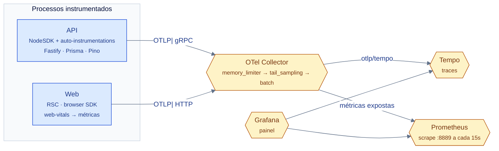

# System Design — Operação

> **Medido em 2026-11-09:** a config do collector, os guards de taxa e os
> timeouts conferem com o código.
> **Dono do desenho:** este documento. **Dono do procedimento:**
> [`docs/runbooks/`](../runbooks/). **Dono do fluxo:**
> [`docs/flows/telemetry-observability/`](../flows/telemetry-observability/).

---

## §1. O pipeline de telemetria



> O **caminho completo**, com o que entra em cada etapa, está em
> [`docs/flows/telemetry-observability/telemetry.collector.otlp.pipeline.dataflow/` — a IR](../flows/telemetry-observability/telemetry.collector.otlp.pipeline.dataflow/telemetry.collector.otlp.pipeline.dataflow.dataflow.json).
> O **procedimento** de subir e consultar está em
> [`docs/runbooks/observabilidade.md`](../runbooks/observabilidade.md).

### §1.1 O sampling — e o que ele **não** garante

O `tail_sampling` decide **por trace**, e as policies são combinadas por
**OR** — a ordem no YAML é irrelevante:

| Policy | O que preserva |
|---|---|
| `errors` | qualquer trace com um span em `ERROR` |
| `slow` | latência acima de **1 s** |
| `baseline` | **5 %** probabilístico — o piso de quem não casou com nenhuma outra |

> ⚠️ **"Sempre preservar" é verdade só no escopo do collector.** A policy
> `errors` guarda todo trace que **chega** com span em erro — ela **não**
> garante que o trace chegue. A camada 1 (o SDK, `tracing.ts` sem `sampler`
> próprio → lê `OTEL_TRACES_SAMPLER`) já descartou ~90 % das raízes **antes**
> daqui, e ela é **cega ao status HTTP**. Ou seja: cerca de 10 % dos traces
> de erro chegam ao collector, e o collector mantém **todos** os que chegam.

> ⚠️ **A ordem importa no outro sentido:** `memory_limiter` é **sempre** o
> primeiro processor de um pipeline que aceita dados do receiver. Sem ele,
> um pico de tráfego OOM-killa o collector.

### §1.2 O que cada processo emite

| Fonte | O que emite | Como |
|---|---|---|
| API | spans de HTTP, Prisma, Fastify | auto-instrumentations (só `fs` e `pino` desabilitados) |
| API | `trace_id`, `span_id`, `trace_flags` **no log** | `PinoInstrumentation` |
| API | log estruturado JSON | Pino, com `authorization` e `cookie` **redigidos** |
| Web (servidor) | spans de RSC | `instrumentation.node.ts` |
| Web (browser) | spans de fetch e interação | `instrumentation-client.ts` |
| Web (browser) | `web.vitals.{lcp,cls,inp,fid,ttfb}` | `web-vitals-reporter.tsx` |

---

## §2. Correlação — a verdade medida

**Não existe uma ponte explícita `request.id` → `traceparent`.** O que existe
são identificadores com uma **ordem de precedência** — e, desde 2026-11-10,
**a mesma ordem para todos**:

```text
traceIdDe(request)                    AuditContext.correlationId
  1º span W3C ativo                    1º span W3C ativo
  2º request.id do Fastify             2º request.id do Fastify
  3º UUID fixado no request            3º UUID fixado no request
```

- `traceIdDe()` (`shared/infrastructure/http/trace-id.ts:42-53`) é o
  identificador que **volta na resposta** (campo `traceId` do
  `application/json` — o repo **não** emite `application/problem+json`) e no
  log do guard de flag.
- O `correlationId` da **auditoria** (`users.controller.ts` — `buildContext()`)
  usa a **mesma função**: `traceIdDe(request)`. E a falha de persistência
  (`UserPersistenceException`) carrega o id do contexto de auditoria — o
  mesmo.
- O `traceparent` **entra** pelo header: a instrumentação HTTP do OTel extrai
  o `traceparent` W3C da requisição e cria o server span a partir dele.

> ✅ **A divergência foi fechada (2026-11-10).** Antes, **sem** span OTel
> ativo, o `traceId` da resposta caía no `request.id` e o `correlationId` da
> auditoria caía em `randomUUID()` — dois ids de famílias diferentes, e
> quem investigava "o que aconteceu neste request" não conseguia casar o
> log com a linha de auditoria pelo mesmo id. Agora **um só**.
>
> ⚠️ **A divergência era entre as DUAS correlações, não entre o doc e o
> código.** `docs/STACK.md` (v1.7.0) fala da **camada de instrumentação** — o
> `traceparent` que entra cria o server span —, que é outra coisa do
> `request.id` que a **resposta** carrega.

**O que date de medição:** `traceIdDe` não grava nada em disco; a
correlação entre log e auditoria **não tem** coluna de trace no schema —
`users_history` guarda `changed_by` e `reason`, não `trace_id`. A
correlação vale **em tempo de request** (resposta, log, exceção), e não na
trilha de auditoria persistida.

---

## §3. Os 3 pilares — e onde cada um está

| Pilar | Ferramenta | Onde vive | Onde se vê |
|---|---|---|---|
| **Métricas** | Prometheus | scrape em `otel-collector:8889` | Grafana |
| **Traces** | Tempo | `otlp/tempo` | Grafana → Explore |
| **Logs** | Pino (stdout) | container | quem indexa é o driver de container |

> **Não há Loki.** O Pino escreve em stdout e **quem indexa é o driver de
> container** — o Compose não tem um backend de log. O log e o trace são
> **dois** streams separados, e a junção entre eles é o `trace_id` no
> campo do log.

---

## §4. SLO — `[derivado]`

> ⚠️ **O repo não define SLO.** Nada em `docs/` ou no código declara uma
> meta de disponibilidade ou latência. O que segue é uma **proposta** para
> o app derivado escolher e medir — não é um fato deste sistema.

| SLI | Definição proposta | SLO proposto | Por que este |
|---|---|---|---|
| **Disponibilidade da leitura** | requisições de leitura que não dão 5xx | **99,5 %** | o acesso de leitura é o caminho crítico do produto |
| **Disponibilidade da escrita** | mutações que não dão 5xx | **99 %** | a escrita tem validação e conflito: 4xx é esperado |
| **Latência de leitura** | p95 do `GET` | **< 500 ms** | o dado é local; acima disso é o banco ou o `EXISTS` da policy |
| **Latência de escrita** | p95 do `POST`/`PATCH` | **< 800 ms** | escreve em 2 tabelas (dado + auditoria) |
| **Erro de tenancy** | respostas 5xx em rota multi-empresa | **0** | qualquer um é um furo de isolamento |
| **Replay de refresh** | detecções de replay por hora | **0** | o detector revoga todas as sessões do usuário: qualquer um é incidente |

**Error budget:** com 99,5 % de disponibilidade, o orçamento é de **3,6 h de
indisponibilidade por mês**. A regra de consumo: se o budget acabar, o
trabalho passa a ser **estabilidade**, não features.

**O que medir para começar:** o `traceId` da resposta + o status HTTP já
existem em toda resposta — a coleta é o que falta, e ela depende do backend
de métricas que o app derivado escolher.

---

## §5. Proteção

| Controle | Valor | Onde |
|---|---|---|
| Rate limit global | **100 req/min** por IP (`THROTTLE_LIMIT`, `THROTTLE_TTL_MS`) — o balde é **por rota** (`generateKey` inclui classe e handler) | `app.module.ts` (`LIMITE_GLOBAL_POR_MINUTO`, `JANELA_GLOBAL_MS`) |
| Rate limit de login | **5/min** por `ip:email` | `auth.controller.ts:85`, `:126` |
| CORS | lista `ALLOWED_ORIGINS`; em produção o bootstrap **aborta** se só houver o default de dev | `main.ts:80-91` |
| Security headers | helmet, com CSP restritiva (a API é JSON pura: `script-src 'none'`) | `main.ts:48-71` |
| Redação de log | `authorization` e `cookie` redigidos | `app.module.ts:16` |
| Erro | RFC 7807, sem stack trace em produção | `global-exception.filter.ts` |

> ✅ **`/health` tem teto PRÓPRIO (desde 2026-11-10).** `main.ts` e
> `app.module.ts` afirmavam em comentário que rotas como `/health` usam
> `@SkipThrottle()` — e **nenhum existia no código** (o grep devolvia só os
> 2 comentários). MEDIDO no container: 120 requisições seguidas devolviam
> **100×200 + 20×429**.
>
> O teto da rota é **600/min** (`LIMITE_DE_HEALTH_POR_MINUTO`), e não o
> global (100/min). A razão é o **probe**: o `HEALTHCHECK` do container roda
> a cada 10 s (6/min) e o **harness de e2e do web** faz poll de
> `/api/v1/health` a cada **200 ms** (`apps/web/e2e/support/api.ts:274`) — 5
> req/s, ou 300/min na pior rajada (o harness desiste aos 45 s: 225
> requests). Com o teto global, essa rajada estourava o balde e o probe
> levava 429 — e um healthcheck que falha derruba o container
> (`depends_on: service_healthy`).
>
> ⚠️ **O preço do teto próprio, declarado:** a rota é **pública** e faz
> `SELECT 1` no banco a cada chamada, então ela **continua sendo um teto**
> (e não uma isenção): é o que fecha o vetor de pressão sobre o pool — que
> §7 aponta como o limite de escala da API. O número é 100× o probe do
> container e 2,6× a pior rajada do harness.

---

## §6. Orçamento de latência

| Camada | Timeout | Medido |
|---|---|---|
| Browser → web | o do fetch do Next | — |
| Web → API | **10 s** é o *fallback* (`?? 10_000`); o cliente real passa `defaultTimeoutMs` por operação — o logout usa **2 s** (`PRAZO_DE_REVOGACAO_MS`) | `api-client.ts:119`, `:209`, `:227` |
| API → banco | **8 s** por statement | `ALTER ROLE app_runtime SET statement_timeout = '8s'` — a decisão está no [ADR-0012](../adr/0012-orcamento-de-tempo-no-banco.md) |

> ✅ **A lacuna do banco foi fechada (2026-11-10).** Antes não havia
> timeout nenhum: um `SELECT` lento segurava a conexão do pool até o Postgres
> desistir. MEDIDO antes: `SHOW statement_timeout` numa sessão `app_runtime`
> → **0** (sem limite); depois: **8s**. O número tem **um dono**
> (`STATEMENT_TIMEOUT_DO_PAPEL`, em `papel-de-runtime.ts`), e o
> `papel-de-runtime.spec.ts` reconcilia a migration com a constante.
>
> ⚠️ **O orçamento é do PAPEL, e do cluster** — o `ALTER ROLE ... SET` vale
> para todos os bancos do cluster, e precisa de superuser (ou `CREATEROLE`).
> O preço está no ADR-0012.

---

## §7. Escala

| Camada | Escala | Limite |
|---|---|---|
| **Web** | horizontal, sem estado | o limite é a origem: é o Next.js que fala com a API |
| **API** | horizontal, sem estado (o access token é stateless) | o limite é o **pool** de conexões do Postgres |
| **Banco** | **vertical** | um banco, uma migration; o custo por empresa está em [`dados.md`](./dados.md) §8 |
| **Observabilidade** | horizontal | o `memory_limiter` do collector é o primeiro processor de propósito |

**O que impede escalar horizontalmente hoje:** a API e o web **são**
stateless, mas o **Postgres é um** e o pool de conexões é por instância.
Duas réplicas da API dobram as conexões abertas.

**Ordem de escala, do mais barato ao mais caro:**

1. **índices** — o `EXISTS` da policy de `users` é a query cara
   ([`dados.md`](./dados.md) §8);
2. **pool** — mais conexões, ou um pooler;
3. **réplicas da API** — trivial, porque são stateless;
4. **replicação do banco** — e aí aparece a **primeira decisão de
   consistência** do sistema (ver [`dados.md`](./dados.md) §4.1).

---

## §8. Degradação — o que acontece quando cada peça cai

| Peça que cai | Efeito | Quem absorve |
|---|---|---|
| **Postgres** | tudo dá 5xx; `/api/v1/health` devolve **503** `degraded` | a API; o container fica **unhealthy** |
| **Coletor** | a telemetria é **perdida** (fila com retry por 300 s); a aplicação **não** sente | o `sending_queue` do exporter |
| **Tempo / Prometheus** | o collector **retenta**; os traces ficam pendurados | o collector |
| **Grafana** | só a visualização | ninguém |
| **Redis** | — | **não existe**; nada cai |
| **Fila** | — | **não existe**; nada cai |

> **A degradação é assimétrica de propósito:** o banco é o único ponto
> único, e todo o resto é derivado dele. A consequência é que **tolerar a
> queda do banco** é o problema de resiliência do sistema — e ele **não**
> está resolvido.

---

## §9. Os ambientes

Sete ambientes, e **cada um tem um dono**:

| # | Ambiente | Como se sobe | Dono |
|---|---|---|---|
| 1 | **Dev local (pnpm nativo)** | `pnpm dev` — Postgres local na máquina | [`docs/como-rodar.md` §1](../como-rodar.md) |
| 2 | **Dev local (Docker, hot reload)** | `docker compose -f docker-compose.yml -f docker-compose.dev.yml up` | [`docs/runbooks/docker.md` §1](../runbooks/docker.md) |
| 3 | **Stack completa (imagens prod)** | `docker compose up -d` | [`docs/runbooks/docker.md` §2](../runbooks/docker.md) |
| 4 | **Perfil de observabilidade** | `docker compose --profile observability up -d` | [`docs/runbooks/observabilidade.md` §1](../runbooks/observabilidade.md) |
| 5 | **E2E local (Playwright)** | `pnpm test:e2e` | [`docs/runbooks/e2e-e-ci.md` §1](../runbooks/e2e-e-ci.md) |
| 6 | **CI (GitHub Actions)** | push/PR | [`docs/runbooks/e2e-e-ci.md` §2](../runbooks/e2e-e-ci.md) |
| 7 | **Conta Cloudflare (verificação)** | manual, **fora** do caminho da requisição | [`docs/runbooks/cloudflare-edge.md`](../runbooks/cloudflare-edge.md) |

> **O ambiente 7 não é parte da arquitetura por padrão** — o runbook entrega
> o **contrato de verificação** da conta Cloudflare (TLS, HSTS, MFA, DNSSEC),
> para uma pessoa conferir no dashboard; a §1 dele diz exatamente o que ele
> não é.

---

## Ver Também

- [`./contexto.md`](./contexto.md) — a topologia e as redes.
- [`./seguranca.md`](./seguranca.md) — de onde vêm os limites de taxa.
- [`./dados.md`](./dados.md) — o custo por empresa.
- [`../fluxo-desenvolvimento.md`](../fluxo-desenvolvimento.md) — o fluxo
  canônico, do primeiro comando ao merge.

---

**Mantido por:** projeto-base contributors
**Versão do documento:** 1.0.0
