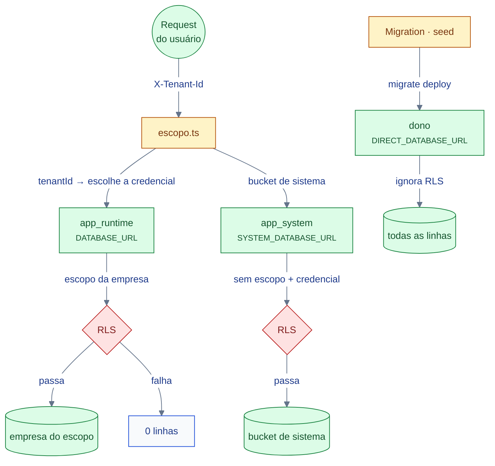

# System Design — Segurança

> **Medido em 2026-11-09:** as 3 credenciais de banco, os guards e as
> migrations de RLS conferem com o código.
> **Dono do desenho:** este documento. **Dono das decisões:**
> [ADR-0002](../adr/0002-autenticacao-jwt-argon2.md),
> [ADR-0004](../adr/0004-tenancy-multi-empresa.md),
> [ADR-0005](../adr/0005-rbac-por-perfil.md),
> [ADR-0006](../adr/0006-feature-flags-como-excecao.md),
> [ADR-0007](../adr/0007-refresh-token-revogavel.md).

---

## §1. As 6 superfícies de ameaça

O sistema tem **6 superfícies** por onde alguém tenta atravessar. Cada uma
tem **um** mecanismo que a fecha — e o mecanismo é o mesmo em toda a tabela:
**a credencial, a policy, ou a recusa explícita**.

| # | Superfície | O ataque | O que fecha | Onde |
|---|---|---|---|---|
| **T1** | **Sessão roubada** | token vazado do navegador ou do log | access token curto (15 min) + **refresh revogável** + cookie `httpOnly` | [ADR-0007](../adr/0007-refresh-token-revogavel.md) |
| **T2** | **Replay de refresh** | re-presentar um refresh token já usado | rotação do `jti` + janela de tolerância de **30 s**; passada a janela, **todas as sessões** do usuário são revogadas (`revogarTodosDoUsuario`) | `auth-use-cases.ts:74`, `:266-277` |
| **T3** | **Empresa vizinha** | ler o dado de outra empresa | **duas** camadas: escopo na aplicação + **RLS**; membership conferida a **cada request**, veredito **não** cacheado | [ADR-0004](../adr/0004-tenancy-multi-empresa.md) |
| **T4** | **Privilégio** | virar admin, ou atravessar a flag | RBAC por perfil + `isAdmin` como bypass + catálogo de permissões **em código** | [ADR-0005](../adr/0005-rbac-por-perfil.md) |
| **T5** | **Membership fabricada** | inserir-se numa empresa | `REVOKE INSERT` do runtime + função `SECURITY DEFINER` com **assinatura HMAC** | [ADR-0004](../adr/0004-tenancy-multi-empresa.md) §5 |
| **T6** | **Segredo exposto** | subir com senha de exemplo, ou com segredo no repo | guard de boot que **recusa o boot**; senha do papel **fora** do versionamento | `shared/infrastructure/prisma/credenciais-do-banco.ts` |

### §1.1 O que **não** é ameaça aqui — e por quê

| Superfície que **não** existe | Por quê |
|---|---|
| **Sessão no servidor** | o access token é **stateless** — não há tabela de sessão para vazar |
| **Escalada via bucket de sistema** | o bucket exige a **credencial** `app_system`; `app_runtime` com `'*'` lê **zero linhas** |
| **Enumeração de empresas** | `tenants.id` é UUID; o `slug` é global, e a listagem exige admin do sistema |
| **Enumeração de convites** | o convite tem **token** (`token UNIQUE`) — não é o id da empresa que prova nada |

---

## §2. As 3 credenciais

O banco tem **3 papéis**, e a diferença entre eles é **a credencial**, não um
valor de configuração.

| Credencial | Papel | Alcança | Quando é usada |
|---|---|---|---|
| `DATABASE_URL` | `app_runtime` | **só** a empresa do escopo | o caminho normal de request |
| `SYSTEM_DATABASE_URL` | `app_system` | o bucket de sistema (todas as empresas) | login, refresh, logout, e o que é **global** |
| `DIRECT_DATABASE_URL` | o **dono** | tudo (inclusive sem RLS) | migrations e seed |



> **`app_runtime` não é membro de `app_system`** — se fosse, um `SET ROLE`
> bastaria e o furo voltaria pela porta dos fundos. `app_system` é um papel
> comum (`NOSUPERUSER NOBYPASSRLS`), com os mesmos privilégios de tabela do
> runtime: a diferença é **a credencial**, e só ela.

### §2.1 O guard de boot

`verificarCredenciaisDoBanco()` roda **antes de conectar** e recusa:

- senha do runtime que está na **denylist** (a que o repositório já
  publicou) ou com **prefixo de exemplo** (`CHANGE_ME…`, `***`);
- `SYSTEM_DATABASE_URL` ausente — **em qualquer ambiente que não seja
  `development`**. É default-deny: `prod`, `staging` e `NODE_ENV` ausente
  passariam, a API subiria, e o primeiro login estouraria 500.

---

## §3. Identidade

### §3.1 A senha

**argon2id**, com os defaults da biblioteca: `m = 65536` (64 MiB por hash),
`t = 3`, `p = 4`. Alternativa rejeitada: **bcrypt**, que trunca a senha em
**72 bytes** — o corte é silencioso e a senha efectiva é menor do que a
escrita.

O hash **nunca sai**: nem no `UserOutputDto`, nem nos snapshots JSONB de
`users_history`/`users_archive`.

### §3.2 O token

O access token é um **JWT stateless**, com **3 claims** — e só 3:

```ts
interface TokenSubject {
  sub: string;              // id do usuário — é o que a auditoria grava como actorId
  email: string;
  typ: 'access' | 'refresh';
}
```

> **O token não carrega o tenant, e essa é uma decisão** ([ADR-0004](../adr/0004-tenancy-multi-empresa.md)):
> o contexto de empresa entra pelo header `X-Tenant-Id`, porque trocar de
> empresa **não** é trocar de token — é a mesma sessão, outra empresa.

| TTL | Padrão | Configurável |
|---|---|---|
| access | `15m` | `JWT_ACCESS_TTL` |
| refresh | `7d` | `JWT_REFRESH_TTL` |

O `JWT_SECRET` é **obrigatório em qualquer `NODE_ENV`** — a API recusa o boot
sem ele.

### §3.3 O refresh revogável

É a peça que fecha T1 e T2.

```text
POST /auth/refresh
  ├─ o jti já está revogado?
  │    ├─ sim, e a revogação tem menos de 30 s  → é retry: devolve erro, NÃO derruba a sessão
  │    └─ sim, e a revogação tem mais de 30 s   → é REPLAY: revoga TODAS as sessões do usuário
  ├─ rotaciona: o jti velho morre, nasce um novo
  └─ devolve o par access + refresh
```

- O `jti` é a **chave primária** de `refresh_tokens` — o identificador do
  token **é** o `jti`.
- A tabela é `REVOKE ALL` de `app_runtime`: só `app_system` lê — login,
  refresh e logout falam com ela pela **credencial de sistema**.
- **A revogação é aguardada antes do 401**: se ela corresse em segundo plano,
  o token revogado continuaria valendo por uma janela.

> **Por que 30 s:** dois `POST /auth/refresh` com o mesmo token são retry de
> cliente, duas abas, dois workers — **não** um ataque. Sem a janela, um
> retry derrubaria a sessão de quem está usando a API de verdade. 30 s
> basta para o retry de rede e é curto demais para ser janela de ataque
> (o token vive 7 dias).

---

## §4. Autorização

O perfil **efetivo** é o da membership do usuário **na empresa escolhida** —
não o `users.profile_id` global.

```text
usuário + empresa (X-Tenant-Id)
   ↓
tenant_memberships.profile_id  →  o perfil efetivo
   ↓
profiles.isAdmin?  →  bypass total (não consulta permissões)
   ↓ não
authorizations (profileId, permissionKey)  →  o catálogo de permissões
```

- As chaves de permissão são **strings hierárquicas** com pontos
  (`users.read`, `admin.manage_profiles`) — mas **não são hierárquicas**:
  ter `admin.*` **não** implica `users.read`.
- O **catálogo de chaves vive em código**
  (`shared/auth/permissions-catalog.ts`), não no banco. O banco guarda a
  **concessão**, o código define o **universo**.
- `isAdmin` é o **bypass total**: mesmo que o perfil "admin" perca todas as
  autorizações, o guard deixa passar. É defesa em profundidade — e também
  um **fio solto** que a revisão precisa ver.
- Perfil **sem** membership resolve para **zero permissões** — deny-by-default.
- `isSystem` impede deletar perfil de sistema (lock-out do admin).

> **A membership é conferida a cada request** e o veredito **não** é
> cacheado. O cache de 5 s carrega `isAdmin` e as permissões do perfil —
> nunca a autorização.

---

## §5. Feature flags como exceção

`feature_flags` guarda **só as exceções**: quem está **desligada**. A linha
ausente significa **ligada**.

```text
chave não encontrada → ativada
chave encontrada com ativada=false → desligada
```

- A **ausência** da linha é o estado normal — o `DEFAULT true` no schema é
  documentação, não mecanismo.
- A flag **não tem `tenant_id`**: ela responde "isto existe no sistema?", e
  a resposta é a mesma para todo ator.
- **Flag desligada → 404 genérico**, não 403. O 403 confirmaria a existência
  do recurso ([ADR-0006](../adr/0006-feature-flags-como-excecao.md)).

---

## §6. Segredos

| Segredo | Onde vive | Regra |
|---|---|---|
| `JWT_SECRET` | ambiente | obrigatório em qualquer `NODE_ENV`; recusa o boot |
| senha de `app_runtime` | ambiente | fora do versionamento; a migration cria o papel `NOLOGIN` e o setup aplica a senha |
| senha de `app_system` | ambiente | idem — **dois** papéis, **duas** senhas |
| `chaves_de_assinatura` | banco | o runtime tem `REVOKE ALL` e RLS **sem policy** |
| `ALLOWED_ORIGINS` | ambiente | em produção, o bootstrap **aborta** se a lista contiver só o default de dev |

**O header `X-Tenant-Id` não é segredo.** Ele é **contexto**, não
credencial: quem o escreve escolhe *qual* empresa quer ver, e a membership é
conferida contra a credencial da sessão.

---

## §7. Auditoria

| O que é gravado | Onde | Quando |
|---|---|---|
| Snapshot JSONB da entidade + versão | `users_history` | a cada mutação |
| Snapshot da entidade arquivada | `users_archive` | no soft-delete |
| Ator, origem, timestamp, `correlationId` | as duas tabelas | junto da mutação |

- A auditoria **acompanha** a mutação: é o mesmo use case que grava.
- O `AuditContext` viaja num `AsyncLocalStorage` — o use case não carrega o
  request.
- O `correlationId` vem do span W3C ativo (ver a ressalva de divergência em
  [`dados.md`](./dados.md) §5).

---

## Ver Também

- [`./dados.md`](./dados.md) — o escopo, a RLS e a credencial na prática.
- [`./contexto.md`](./contexto.md) — as fronteiras de confiança.
- [`./operacao.md`](./operacao.md) — como a segurança aparece no log.
- [`../api/auth.md`](../api/auth.md) — o contrato HTTP do BC `auth`.

---

**Mantido por:** projeto-base contributors
**Versão do documento:** 1.0.0
